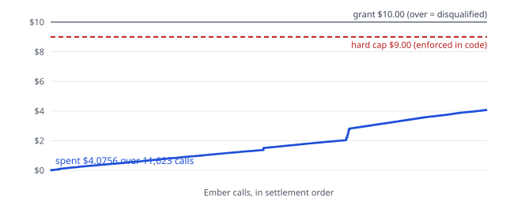

# ForgeEmber

**ForgeEmber screens every email, invoice, receipt photo, voicemail and screen recording a small business receives, for a fraction of a cent each, and holds every payment and bank-detail change for a person, with a concrete next step.**

Small businesses lose money to invoice fraud, "our bank details have changed" messages and fake calls from the boss. They have no security team, and checking every item by hand is too slow. ForgeEmber checks all of it, on Muse Ember.

> **Ember proposes; code decides; a person acts.** Ember reads, listens and proposes. Deterministic code verifies every claim against the source and the business's own records, and only `policy.py` decides. Payments, bank-detail changes, outside sends and deletions are always held, never executed.

**▶ Start here: [Invoice MVC-1047, start to finish](https://billyrdavis1985-bot.github.io/ForgeEmber/cases/invoice-1047.html)**, a two-minute keyless replay of a recorded live run · [every decision trail and the budget evidence](https://billyrdavis1985-bot.github.io/ForgeEmber/) (also in [`site/`](site/index.html)) · demo video: _link goes here on Dec 1_

## Results at a glance

Measured on recorded live runs with `muse-ember-1.0`; each row links to its evidence in this repo. The cost row is a projection from the measured per-message cost.

| What | Result | Evidence |
|---|---|---|
| **Real phishing, at scale** | 3,340 of 3,458 real phishing emails (96.6%) sent to review; 118 missed. 6,458 emails in all for $1.75 ($0.27 per 1,000) | [`traces/scale/`](traces/scale/) |
| **Real receipt photos** | 998 photos read straight from the image: 98.7% of totals correct against human labels, for $0.76 | [`traces/scale/`](traces/scale/) |
| **One supplier payment, end to end** | A voicemail asking to divert invoice 1047 turned the waiting payment HIGH, with the number to call from the business's own records; an unrelated invoice stayed separate; screening the invoice again kept the caution. 5 of 5 steps | [replay](https://billyrdavis1985-bot.github.io/ForgeEmber/cases/invoice-1047.html) |
| **Frozen attack suite** | 10 of 10 attacks defended by the defense each one names: look-alike letters, hidden PDF text, instructions to the AI in a PDF, a photo and a voicemail, an account number posing as an invoice number | [`traces/attacks/`](traces/attacks/) |
| **Ordinary mail** (the false-alarm question) | On 25 tricky but legitimate messages, labeled before running: 2 of 18 routine ones interrupted the owner; 0 of 7 that needed a check were missed | [`traces/ordinary/`](traces/ordinary/) |
| **Labeled fixtures (Gate A)** | 25 of 25 right on risk and held actions, including fraud by voicemail, a fake vendor caught through a tool call and a bank change in a screen recording; routing 100%, fields 94.6% | [`traces/eval/`](traces/eval/) |
| **What it costs a business** | About $0.50 a month for 20 items a day (our assumption), at the measured $0.0008 per message | [`traces/ordinary/`](traces/ordinary/) |
| **Budget** | $4.14 of a $9.00 hard cap enforced in code (the event's limit is $10). Every call is one line in the trace; reconciled with Meta's Usage page on Nov 28, ledger above Meta as required | [Budget & Trace](#budget--trace) |

**Limits, stated up front:** the 3,000 benign emails in the scale run are synthetic (9 templates); the ordinary-mail and attack sets were written by us, with labels fixed before running; Gate A's routing prompt was revised after seeing earlier failures, so its routing score isn't a blind test. Details in [Results](#results).

## Hackathon fit

- **Problem statements:** (1) *Cheap enough to run on everything*: the same task over thousands of real items, end to end. (2) *Beyond text, under budget*: emails, PDFs, scans, photos, voicemails and screen recordings in, verified actions out.
- **Prizes we're aiming for:** Best Frontier Build · Scale the Real World
- **Model:** Muse Ember (`muse-ember-1.0`) through the Meta Model API, for every agent
- **Built by:** Billy Davis, solo, Nov 23–Dec 2, 2026, with Muse Code (Muse Spark) and Claude as AI coding assistants; no pre-existing code

## How it works

```
INPUTS           ENVELOPE              EMBER AGENTS (muse-ember-1.0)         CODE (the only authority)           OUTPUTS
.eml email  -+   id, sha256,        -> Coordinator: triage, minimal       -> Sender: lookalikes (letters,     -> Held for a person (T2):
PDF invoice  |   parts, sniffed        Document: invoice and receipt         punycode), impersonation,           payments, bank changes,
photo / scan |   mime, text layer,       fields from PDFs and photos         Reply-To, injection, file type      each with a next step
voicemail    |   hidden PDF text,      Voicemail: what the caller said       Verify: quotes, totals, IBAN,       Filed and tagged (T0)
screen rec. -+   invisible chars       Video: what the recording shows       account on file, lookup ids         Operator notified (T1)
                 (code reads it        Identity: lookup_vendor calls         History: follow-ups, duplicates     Receipt per item
                 first)                Risk + skeptic: on escalation         Policy: risk and tiers              Ledger + call trace
                                       Handoff: drafts from code's facts     Budget: reserve, cap, settle
```

1. **Code looks first**, before any model call: lookalike sender domains (including look-alike letters and punycode), executive impersonation, diverted replies, instructions aimed at an AI, hidden PDF text, invisible characters, file-type tricks.
2. **Ember proposes.** A coordinator triages every item at `minimal` effort; specialists at `low` effort read documents and photos, listen to voicemails, watch screen recordings and look vendors up. Every claim quotes its source.
3. **Code verifies.** Quotes must exist in the source; totals must add up; an IBAN must pass its checksum and the account must be one on file; a vendor Ember names must have come back from a lookup. A later message about a waiting invoice is linked to it, and a repeat of an invoice already waiting or paid is caught. A message whose text gives an account or asks for payment stays on a money route, whatever triage called it. A model can raise risk, never lower it.
4. **Policy decides; a person acts.** Filing is automatic (T0), the operator is notified (T1), and payments, bank-detail changes, outside sends and deletions are held (T2). Every hold says what to do next, using the contact details on file, with a drafted check to the vendor that ForgeEmber never sends. Approving a hold marked "check first" needs a written record of how it was checked.

Full design: [`docs/ARCHITECTURE.md`](docs/ARCHITECTURE.md).

## Meta tooling, and the job each piece does

| Capability | Its job in ForgeEmber | In use |
|---|---|---|
| Responses API on `muse-ember-1.0` | Every agent call, stateless (`store: false`), through one budgeted client | Over 11,700 live calls, each reserved and settled in the ledger and logged in [`traces/calls.jsonl`](traces/calls.jsonl) |
| Reasoning-effort levels | `minimal` for triage, `low` for specialists, never Ember's default `max` | Set on every call; reasoning is still 66% of output tokens, so effort is the main cost lever |
| Structured output (`text.format` JSON schema) | Strict outputs, validated again by Pydantic | Eight schemas (triage, invoice/receipt, voicemail, video, identity, risk, skeptic, handoff draft); every finding quotes its source and code checks it |
| Native PDF and image input | Invoices, scans and receipt photos to fields, with no OCR library | 998 real receipt photos, 98.7% of totals correct ([Results](#real-receipt-photos-nov-24)) |
| Native audio input | Voicemails to actions | Right on risk and holds in every run; a recording never confirms bank details ([Results](#beyond-text)) |
| Native video input | Screen recordings of payment portals | A payee edit read right and held HIGH ([Results](#beyond-text)) |
| Input-token count endpoint | Bounds every audio and video call before it is sent | The ledger reserves the counted worst case for each media call |
| Tool calling | A read-only `lookup_vendor` the model asks for; code runs it and checks the answer | Turned a fake vendor from MEDIUM to HIGH; hosted tools are refused ([Results](#beyond-text)) |
| Prompt caching | Stable instructions first, one `prompt_cache_key` per prompt version | About 46% of 17M input tokens served from cache, over $0.75 saved |
| Multi-agent on Ember | A coordinator plus specialists, all on Ember; code decides which run | Coordinator, document, voicemail, video, identity, risk, skeptic and handoff drafter |
| Muse Code | Muse Spark coding sessions and pull-request reviews | Spark cross-reviewed the security code (PR #37 and earlier). Trajectory exported with `/export trajectory` as `traces/muse-code-trajectory.json` (not `traces/usage-trajectory.json`, which is our own spend history) |

## Try it

**Without a key**: the [replay site](https://billyrdavis1985-bot.github.io/ForgeEmber/) shows every recorded decision trail, the three case pages and the budget evidence. It is built from the committed traces (`uv run forgeember site build`) and published to GitHub Pages by [`.github/workflows/pages.yml`](.github/workflows/pages.yml).

```bash
uv sync
uv run pytest                            # full test suite: fakes only, no network
uv run forgeember budget                 # budget report from the local ledger
uv run python scripts/gen_fixtures.py    # regenerate every fictional fixture
```

**With a key**: every live call needs `--live` and a budget stage, and none runs in CI.

```bash
read -rsp "Paste key, then Enter: " MODEL_API_KEY && export MODEL_API_KEY && echo
uv run forgeember screen fixtures/emails/em-001-bank-change-lookalike.eml --stage dev --live
uv run forgeember console            # approval console at http://127.0.0.1:8000 (--port to change it)
uv run forgeember scenario fixtures/scenarios/invoice-1047.json --stage demo --live
uv run forgeember eval --stage eval --live       # Gate A: the 25 labeled fixtures
uv run forgeember attacks --stage eval --live    # the frozen attack suite
uv run forgeember ordinary --stage eval --live   # the ordinary-mail set
```

**At scale**: build the corpora (free), then screen them in bulk mode, resumable and capped by the `scale` stage.

```bash
uv run python scripts/make_corpus.py benign --n 3000   # fictional benign mail
uv run python scripts/make_corpus.py nazario           # Nazario phishing corpus, CC BY 4.0
uv run forgeember batch data/benign-v1 data/nazario/eml --stage scale --live --limit 200
uv run python scripts/make_corpus.py cord              # 1,000 CORD receipt photos, CC BY 4.0
uv run forgeember batch data/cord --stage scale --live --workers 8   # scores totals vs. labels
```

## Results

All runs are on `muse-ember-1.0`, in 2026; every call is one line in [`traces/calls.jsonl`](traces/calls.jsonl). Each result gives the number, how it was measured, its limits and its evidence. How each one got there, including what failed first, is in [`docs/BUILD_LOG.md`](docs/BUILD_LOG.md).

### At scale

#### Real phishing (Nov 23–24)

| | |
|---|---|
| Result | **3,340 of 3,458 real phishing emails (96.6%) sent to review; 118 missed.** 9 false alarms in 3,000 synthetic benign emails |
| Cost | **$1.75 for 6,458 emails, $0.27 per 1,000**; about 22 minutes with 8 workers; 48% of input tokens served from cache |
| How measured | Bulk mode. Phishing: the [Nazario corpus](https://monkey.org/~jose/phishing/) (2015–2025, CC BY 4.0). "Sent to review" means rated MEDIUM or HIGH, so a person sees it. 1 byte-identical duplicate skipped. The totals combine the main run (`scale-20261124T003510Z`: 3,325 sent to review) with two resumed runs that screened the 15 emails it couldn't (`…015505Z`, `…020838Z`: 8 and 7, all sent to review) |
| Limits | The benign side is synthetic (9 templates) and easier than a real inbox; [Ordinary mail](#ordinary-mail-the-hard-kind-nov-27) below measures that question differently. The phishing runs' ledger total is $2.78, not $1.75: it includes the 200-item pilot and 89 failed or refused calls kept at their full worst-case reservation (mostly 7 crafted PDFs the API couldn't process). The `scale` stage's $3.54 in the budget table also includes the receipt photos |
| Evidence | [`traces/scale/`](traces/scale/) |

#### Real receipt photos (Nov 24)

| | |
|---|---|
| Result | **998 photos read straight from the image: 98.7% of totals correct** (957 of 970 with a human label). 99.5% routed as receipts (record the expense, nothing to pay); the other 5 were read as invoices, so their payments were held. Nothing is ever paid automatically |
| Cost | **$0.76 for the run, $0.00076 per photo** (2 calls each); about 7 minutes, 0 errors |
| How measured | [CORD v2](https://github.com/clovaai/cord) (CC BY 4.0): creased, shadowed, skewed phone photos of Indonesian shop receipts. Each photo goes to Ember as an image; no OCR library. Totals compared by value: "60.000" and "60000" match, "60.50" and "6050" don't |
| Limits | A first, digits-only scorer reported 99.0% by counting 3 such misreadings as right; the saved outputs were rescored ([`scripts/rescore_receipts.py`](scripts/rescore_receipts.py)). A blinded re-run of 200 photos under neutral file names: 98.5% of totals, $0.15 |
| Evidence | [`traces/scale/`](traces/scale/) |

### The payment workflow

#### One supplier payment, end to end: invoice 1047 (Nov 25–27)
- **Result: 5 of 5 steps, live.** A voicemail asking to pay invoice 1047 to new bank details turned the waiting payment from LOW to HIGH, with "Call Marrowvale Couriers on 01632 960481, the number in your records, not one given in this message… The caller gave 01632960735, which is not that number." A voicemail about invoice 1052 stayed separate. Screening the invoice again kept the caution. [Replay](https://billyrdavis1985-bot.github.io/ForgeEmber/cases/invoice-1047.html)
- **How it works:** code links a later item to an open payment when that invoice's number appears in it as a whole token (a spoken "1047" counts) and the vendor matches, or, if no vendor can be resolved, when exactly one open invoice fits. A link can only add caution, and its note is code's wording, never the caller's.
- **Limits:** three live failures were found and fixed in code on the way (a recording read as an invoice; a misheard company that blocked the link; a second screening that reset the hold to LOW). Fixtures are fictional.
- **Evidence:** [`fixtures/scenarios/invoice-1047.json`](fixtures/scenarios/invoice-1047.json), [`traces/scenarios/`](traces/scenarios/)

#### A corrected invoice, and the same invoice twice (Nov 26–27)
- **Result: both 2 of 2, live.** A corrected invoice with a higher total gets its own step on both holds ("…not the 634.80 on the invoice already waiting. Check the revised charge against your order… then approve only one of the two holds for this invoice"), and the original rises to MEDIUM. A copy of an invoice re-sent by email is MEDIUM with "approve only one of the two", and the original is warned too. [Replay](https://billyrdavis1985-bot.github.io/ForgeEmber/cases/duplicate-invoice.html)
- **How it works:** before a payment is filed, code checks the hold history for the same vendor: the same invoice number already approved ("this may ask for the same money twice"), the same number and amount already waiting, or the same amount under a new number within 14 days. Rejected payments don't count, monthly bills (about 30 days apart) don't trip it, and `policy.py` rates a duplicate MEDIUM.
- **Evidence:** [`fixtures/scenarios/`](fixtures/scenarios/), [`traces/scenarios/`](traces/scenarios/)

#### What the owner is told
- **Every hold has a next step,** written by code from verified facts and the contact details on file, never from the message under review. Where the vendor should confirm, a drafter on Ember writes a short message to the vendor's address on file; it sees only code's facts, code rejects any draft with a link, an address or a long number, and ForgeEmber never sends it. Approving a hold marked "check first" needs a written record of how it was checked, or the console refuses it.
- **Result:** across the 60 recorded trails on the replay site, 18 got a draft and code rejected none; $0.0050 for all 34 drafter calls, test runs included.

### Beyond text

| Input | Result (live) | Cost | Limits |
|---|---|---|---|
| **Voicemails** (7, text-to-speech; MP3, and a WAV attached to an email) | Decisions and holds right for all 7 in every Gate A run since Nov 26: a bank change read out and a caller using the owner's name are HIGH and held; routine calls are filed | about $0.0006 routine, $0.002 fraud attempt | Spoken digits were often misheard, so a recording never confirms bank details; company names are matched by sound ("Kestrel Bite Posting" to Kestrel Byte Hosting) |
| **Screen recording** (1, 10 s, 720p) | Payee, sort code and account read right; the account isn't on file, so HIGH and the change held | $0.0025 uncached, $0.0014 with 80% cached | One recording isn't a benchmark; it shows the path works end to end |
| **Tool calling** (`lookup_vendor`) | em-008, "Fennimore Stationery" writing from `fmr-supplies.example`: Ember looked the name up; code verified the quoted claim, that the vendor id came from that lookup, and that the domain isn't Fennimore's: HIGH, not MEDIUM | under $0.0005, 2–3 rounds | Lookups return names, domains and usual amounts, never bank details |

### Robustness

#### Frozen attack suite (Nov 26)
- **Result: 10 of 10 defended live by the defense each one names; 10 of 10 held; $0.019.**
- **How measured:** 10 fictional attacks, frozen before any run ([`fixtures/attacks/`](fixtures/attacks/manifest.json)): a punycode sender domain, a longer lookalike domain, white-text instructions to the AI, a PDF whose invisible text layer shows the account on file while the page shows another, a note to the AI in a photo and one in a voicemail, zero-width characters in an IBAN, an account number posing as an invoice number to reach the drafted message, a request to put a payment link in the reply, and a vendor name with a Cyrillic letter. Fixes went in code, never in a prompt.
- **What it found:** before the fixes, with a model that noticed nothing, the doctored PDF came out LOW ("approve when it's due"), the account number reached the drafted message, and both lookalike domains were only "not one of your vendors". With the fixes, code alone defends 9 of 10 against that blind model; the note in a photo needs Ember to report it, since code can't read pixels (it was held either way, and live Ember reported it).
- **Limits:** we wrote the attacks; the PDF scan reads page content streams, not form XObjects.
- **Evidence:** [`traces/attacks/`](traces/attacks/)

#### Ordinary mail, the hard kind (Nov 27)
- **Result: 2 of 18 routine messages interrupted the owner for nothing; 0 of 7 that needed a check were missed; $0.079 per 100 messages.**
- **How measured:** 25 legitimate messages a small business really gets ([`fixtures/ordinary/`](fixtures/ordinary/manifest.json)), labeled before any run. Routine: reminders, a "FINAL REMINDER" with a late fee, a statement, invoices, the owner forwarding one, a password-expiry notice, the bank, a credit note, a corrected invoice. Check: a genuine bank change, an invoice far above usual, a new supplier, an accounts-email change, a wrong subtotal, a redelivery fee by voicemail, the owner paying a new contractor. Measured once; nothing tuned to it.
- **Why the two:** a deliberate rule, that a model can raise risk but never lower it. Triage quoted real urgency ("a GBP 10.00 late fee is added if payment isn't received by Friday"; the owner's "Can we pay Marrowvale's invoice 1047 today"); code found the quotes in the message, so they counted as MEDIUM though the second reader said benign.
- **Limits:** written by the builder's AI assistant, so not an independent test.
- **Evidence:** [`traces/ordinary/`](traces/ordinary/)

#### Misfiled payment requests (Nov 28, offline)
- **Result: 120 of 120 misfilings keep every payment and bank-change hold** (before the fix: 84), and none that should be flagged comes out LOW.
- **How measured:** each of the 30 money items in Gate A and the attack suite, with triage forced to each wrong route (ordinary business, other, marketing, receipt) and no warning signs. Fake models, $0 ([`tests/test_money_route.py`](tests/test_money_route.py)).
- **What it found:** policy holds a payment only on a money route, and the route came from triage. Documents, voicemails and videos were safe, since code reads every one whatever triage says. But all 9 money requests sent as plain email lost their hold when misfiled, and one fake-vendor email came out LOW. Code now reads the text too. An IBAN, a labelled account number, or a request to pay an amount or an invoice keeps the message on a money route, and account details said to be new add the bank-change hold. It only raises a route, never lowers one.
- **Limits:** this tests code, not Ember. The wording it knows is English. The live runs above weren't repeated: no route they gave changes (a test checks this). The scale run predates the fix, and the detector fires on none of its 3,000 benign emails, so its false-alarm count stands.
- **Evidence:** [`tests/test_money_route.py`](tests/test_money_route.py), [`src/forgeember/moneytext.py`](src/forgeember/moneytext.py)

### Labeled fixtures (Gate A, Nov 27)
- **Result: 25 of 25 right on risk and held actions; routing 100%; extracted fields 94.6%; $0.0297.** Every Gate A run since Nov 25 has scored 100% on risk and holds as the set grew from 18 to 25.
- **How measured:** 25 fictional items with known answers (7 invoices, 10 emails, 7 voicemails, 1 screen recording): bank-detail changes by email, voice and screen recording, CEO impersonation by email and voice, lookalike domains, a vendor's name from the wrong domain, Reply-To diversion, tampered IBANs, inflated totals, prompt injection, a corrected and a re-sent invoice. Bare files reach the model under neutral names ("document.pdf"), so a file name can't hint at the answer.
- **Limits:** the routing prompt (`triage.v5`) was revised after `triage.v4` failed the routing bar (88.9%), so its routing score isn't a blind test. Fields fall short where spoken digits were misheard.
- **Evidence:** [`traces/eval/`](traces/eval/)

#### Does the skeptic earn its call? (Gate C, Nov 23)
- **Result: no measurable gain on this set.** With the skeptic off, the 13-item eval of the day stayed at 100% on risk and held actions, and cost fell from $0.0152 to $0.0077. The skeptic changed 0 of 13 decisions.
- **Decision:** off in bulk runs. It still runs on escalated items in interactive screening, where a flat contradiction (likely fraud against benign) turns Ember's verdict into "suspicious". Code's facts are untouched either way.
- **Limits:** 13 items, one run each, on an early version of the set.
- **Evidence:** [`traces/eval/eval-20261123T232933Z-escalated.json`](traces/eval/eval-20261123T232933Z-escalated.json) (skeptic on), [`traces/eval/eval-20261123T235343Z-off.json`](traces/eval/eval-20261123T235343Z-off.json) (off)

## Budget & Trace

The event allows $10 of Meta Model API spend, and going over it disqualifies us. Meta's spend alert only sends an email, so **ForgeEmber enforces its own hard cap of $9.00 in code**:

- **Reserve, then settle.** Before every call, the ledger reserves its worst-case cost: input upper bound × input price + `max_output_tokens` × output price, at the right price tier. It refuses the call if the stage limit or the global cap would be crossed. After the call, it settles at the API's reported usage.
- **Reasoning tokens bill as output.** A failed call, or one with missing usage, keeps its full reservation as spent. An overrun is recorded at its real cost, never trimmed.
- **Stage sub-budgets:** dev $1.50 · eval $1.50 · scale $4.00 · demo $0.75 · reserve $1.25. Moving money between stages needs Billy's named approval and is logged.
- **Every call is one line** in [`traces/calls.jsonl`](traces/calls.jsonl), with tokens (input, cached, output, reasoning), cost, prompt version and sha256, input kind, item id, outcome, latency and the API response id. No secrets, enforced by a pattern check.
- **Reconciled against Meta's own Usage page** with `forgeember budget reconcile`. The ledger must never come in under Meta's bill.

**Proof of usage, and why Meta's Spend card shows $0.00.** This account's usage is paid from existing credit on the account (the event's credit was requested but not received), so Meta's Usage page shows Spend $0.00: that card counts billed charges, not usage. Meta's own token counts for Nov 23–27, filtered to Muse Ember (the same scope as our trace), are 16.9M input tokens (46.8% cached), 4.5M output tokens and 11.4k requests, which is **$3.15–3.21 at Muse Ember's list prices** (the range covers the page's rounding). The usage recorded in our trace prices at $3.19, inside that range. The ledger is higher ($4.14 when reconciled on Nov 28) by design: it keeps each failed call's worst-case reservation as spent. The $10 limit and the $9.00 cap in code apply whichever credit pays.

The block below is generated from the ledger by `scripts/render_budget_readme.py`. CI fails if it drifts from the committed snapshot and trace.

<!-- budget:start -->
<!-- Generated by scripts/render_budget_readme.py from traces/budget-snapshot.json. Do not edit by hand: CI fails if this block drifts from the ledger. -->

| Metric | Value |
|---|---|
| Total spent | **$4.1362** of the $10.00 limit |
| Hard cap enforced in code | $9.00 (headroom **$4.8638**) |
| Ember calls recorded | 11,823 (0 over their reservation) |
| Items screened | 7,516 |
| Cost per item | $0.000550 |
| Cost per 1,000 items | $0.5502 |
| Projected monthly cost, small business (3,000 emails) | $1.6507 |
| Prompt-cache hit rate | 45.9% of 17,209,442 input tokens |
| Saved by prompt caching | $0.7590 |
| Reasoning share of output tokens | 66.4% |
| Last reconciliation with Meta's Usage page | 2026-11-28: Meta $3.21, ledger $4.1362 (ledger >= Meta) |

| Stage | Limit | Spent | Open | Remaining |
|---|---:|---:|---:|---:|
| dev | $1.50 | $0.0062 | $0.00 | $1.4938 |
| eval | $1.50 | $0.4455 | $0.00 | $1.0545 |
| scale | $4.00 | $3.5370 | $0.00 | $0.4630 |
| demo | $0.75 | $0.1447 | $0.00 | $0.6053 |
| reserve | $1.25 | $0.0028 | $0.00 | $1.2472 |

| Input kind | Spent |
|---|---:|
| audio | $0.1122 |
| email | $2.9716 |
| image | $0.9195 |
| pdf | $0.1016 |
| text | $0.0208 |
| video | $0.0104 |

| Agent role | Spent |
|---|---:|
| cache_probe | $0.0006 |
| coordinator | $2.0098 |
| document | $1.3623 |
| handoff | $0.0050 |
| identity | $0.0092 |
| risk | $0.6135 |
| skeptic | $0.0826 |
| smoke | $0.000025 |
| video | $0.0028 |
| voicemail | $0.0503 |



Ledger as of: 2026-11-27T13:24:14.706Z. Full per-call trace: `traces/calls.jsonl`.
<!-- budget:end -->

## Data and licenses

Every dataset's license is checked at its primary source before download. See [`docs/DATA.md`](docs/DATA.md). Demo material uses our own fictional fixtures. Results on public corpora are shown only as aggregate statistics.

## How this was built

Built solo by Billy Davis during the Meta Muse Ember Hackathon (Nov 23–Dec 2, 2026). AI coding assistants: **Muse Code (Muse Spark)** and **Claude (Claude Code)**. Billy approves every plan, holds the API key and merges every pull request. Every line of code was written during the event. Nothing was copied from earlier projects. The session-by-session record is in [`docs/BUILD_LOG.md`](docs/BUILD_LOG.md).

## License

[MIT](LICENSE)
